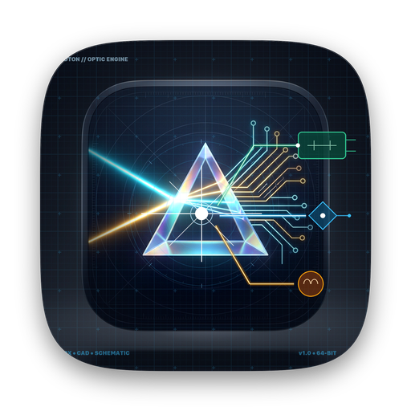
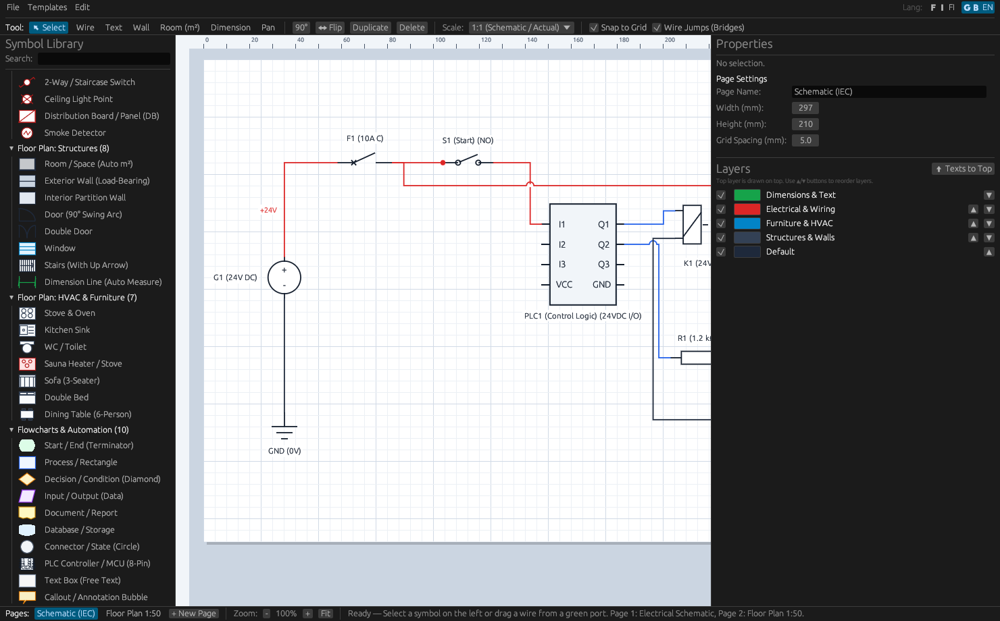

# PhotonDiagram ⚡📐

[](https://github.com/pietini69/photondiagram/releases)
[](https://www.gnu.org/licenses/gpl-3.0)
[](#downloads)
[](https://www.rust-lang.org/)

**PhotonDiagram** is a modern, high-performance, native technical diagramming, electrical schematic, and 2D CAD application engineered from scratch in **Rust**.

Designed as a lightweight, subscription-free alternative to Microsoft Visio, AutoCAD, and heavy web-based diagramming tools, PhotonDiagram launches instantly, renders complex drawings at smooth 60+ FPS on any hardware, and features deep interoperability with industry CAD/CAM formats — including full `.vsdx` roundtripping and direct export to **PhotonCAM / LightBurn** (`.lbrn2`).

<p align="center">
  
</p>

<p align="center">
  
</p>

---

## 🚀 Key Highlights

- **⚡ Blazing Fast & Lightweight:** Built in 100% pure Rust with hardware-accelerated rendering (`egui`/`eframe`). Instant startup with no Electron or browser overhead.
- **📑 Full Microsoft Visio® Interoperability:**
  - **`.vsdx`**: Complete import and export support for modern Office Open XML drawings.
  - **`.vssx`**: Import custom third-party Visio stencil packages and symbol libraries.
  - **`.vdx`**: Full Visio XML drawing import.
  - **`.vsd`**: Legacy binary Visio drawing inspection and text extraction.
- **🔌 Electrical & Automation CAD:**
  - **IEC 60617 Standard Schematics:** Relays, circuit breakers, contactors, coils, pushbuttons, resistors, capacitors, fuses, and PLC I/O blocks.
  - **SFS Installation Symbols (Finnish Standard):** 1/2/3-gang sockets, multi-way switches, distribution sub-panels, sauna stoves, thermostats, and floor heating elements.
- **🏗️ Architectural & Floor Plan Stencils:**
  - Parametric walls, rooms, single & double hinged doors, sliding doors, windows, and structural dimensioning with architectural drawing scales (1:1, 1:20, 1:50, 1:100).
- **🔀 Smart Orthogonal Routing & Wire Jumps:**
  - Dynamic connector routing that automatically snaps to component connection points.
  - **Automatic wire jump bridges (arc bridges)** whenever schematic wires cross!
- **🏭 Direct CAD/CAM Bridge to PhotonCAM & LightBurn (`.lbrn2`):**
  - Export electrical panel faceplates, architectural signs, and machine tags directly to laser cutting and CNC engraving paths.
- **📐 Universal Vector & Data Exports:**
  - Clean vector **SVG**, AutoCAD **DXF (R12/2000)**, and Bill of Materials **BOM (CSV)** for automated purchasing lists.

---

## 🛠️ Supported File Formats

| Format | Extension | Import | Export | Description |
|:---|:---:|:---:|:---:|:---|
| **PhotonDiagram** | `.pdiag`, `.pvis` | ✅ | ✅ | Native lossless JSON format |
| **Microsoft Visio Drawing** | `.vsdx` | ✅ | ✅ | Open XML drawing format with full shape geometry |
| **Microsoft Visio XML** | `.vdx` | ✅ | ✅ | Legacy Visio XML drawing format |
| **Microsoft Visio Binary** | `.vsd` | ✅ | — | Legacy binary OLE2 format text & layout reader |
| **Visio Stencil Library** | `.vssx` | ✅ | — | Third-party symbol library packages |
| **PhotonCAM / LightBurn** | `.lbrn2`, `.lbrn` | ✅ | ✅ | Laser cutting & CNC engraving CAM format |
| **Scalable Vector Graphics** | `.svg` | — | ✅ | Crisp vector graphics for web & print |
| **AutoCAD Drawing Exchange** | `.dxf` | — | ✅ | Industry-standard 2D CAD vector format |
| **Bill of Materials** | `.csv` | — | ✅ | Tabular part list and component quantities |

---

## 📦 Downloads & Installation

Pre-compiled standalone packages are available on the **[Releases](https://github.com/pietini69/photondiagram/releases)** page:

### 🍎 macOS (Apple Silicon & Intel 64-bit)
1. Download **`PhotonDiagram-1.0.0-universal.dmg`**.
2. Open the DMG and drag **PhotonDiagram** into your `/Applications` folder.
3. **First Launch Note (macOS Gatekeeper):** Because this is an independent open-source release without a paid Apple Developer notarization certificate, macOS may show an *"unidentified developer"* prompt on the first launch. To open it:
   - **Right-click** (or Ctrl-click) **`PhotonDiagram.app`** in `/Applications` and select **Open**, or
   - If macOS Sequoia/Tahoe blocks it, open **System Settings → Privacy & Security**, scroll down, and click **Open Anyway** (or run `xattr -cr /Applications/PhotonDiagram.app` in Terminal).

### 🪟 Windows (10 / 11 64-bit)
1. Download **`PhotonDiagram-1.0.0-windows-x64.zip`**.
2. Extract the archive anywhere (e.g. `C:\PhotonDiagram`).
3. Double-click **`PhotonDiagram.exe`** to run.
4. **First Launch Note (Windows SmartScreen):** On the very first launch, Windows Defender SmartScreen may display *"Windows protected your PC"*. Click **More info** and then **Run anyway**.

### 🐧 Linux (x86_64)
1. Download **`PhotonDiagram-1.0.0-linux-x86_64.tar.gz`**.
2. Extract the archive: `tar -xzvf PhotonDiagram-1.0.0-linux-x86_64.tar.gz`
3. Launch: `./photondiagram`

---

## 🔨 Building from Source

Ensure you have a modern Rust toolchain installed ([rustup](https://rustup.rs/)):

```bash
# Clone the repository
git clone https://github.com/pietini69/photondiagram.git
cd photondiagram

# Run tests
cargo test

# Build and run with release optimizations
cargo run --release
```

### Multiplatform Packaging Scripts
PhotonDiagram includes automated packaging scripts in the `scripts/` directory:
- `./scripts/build_dmg.sh universal` — Builds Universal 2 macOS DMG & App bundle.
- `./scripts/build_windows.sh` — Cross-compiles Windows x64 binary using `cargo-xwin`.
- `./scripts/build_linux.sh` — Cross-compiles Linux x86_64 tarball using `cargo-zigbuild`.
- `./scripts/build_all.sh` — Builds all three platform distributions into `dist/`.

---

## 📄 License

PhotonDiagram is free software licensed under the **GNU General Public License v3.0** (GPL-3.0-or-later). See [LICENSE](LICENSE) for full details.

Copyright © 2026 Niko Pietinen.
